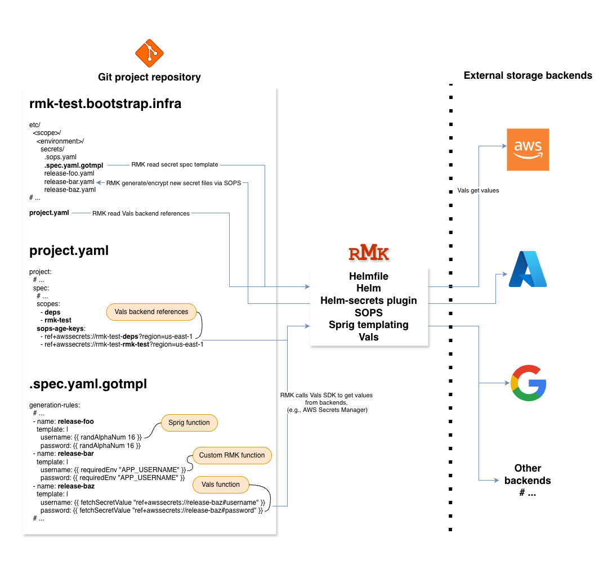

# Integration with Helmfile Vals

## Overview



## Classic secrets management via Git, SOPS and Age

RMK utilizes [SOPS](https://github.com/mozilla/sops) and [Age](https://github.com/mozilla/sops#encrypting-using-age)
for [secrets management](./secrets-management.md). This provides a consistent and auditable mechanism for handling
secrets.

RMK also promotes [batch secrets management](./batch-secrets-management.md), an approach for generating and
maintaining secrets in batch mode.

Key characteristics of the **Git-based** approach:

- Secrets are generated and encrypted using [Golang templates](https://pkg.go.dev/text/template)
  and [Sprig](https://masterminds.github.io/sprig) functions.
- Encrypted files are stored and versioned in [Git](https://git-scm.com/).
- Encryption keys and secret rotation are managed by repository administrators or release managers.
- Operates per project, scope, and environment level.

> This approach for secrets management remains the **standard** and **manual** method in RMK.

## Alternative secrets management via Helmfile Vals and third-party backends

### Introduction

[Helmfile](https://helmfile.readthedocs.io/en/latest/) is used by RMK as its declarative release management layer
for [Helm](https://helm.sh/)-based deployments.  
It includes built-in integration with [Vals](https://github.com/helmfile/vals), allowing configuration parameters
and secrets to be dynamically resolved from **third-party backends** during render time.

Popular Vals backends include:

- [awssecrets](https://github.com/helmfile/vals?tab=readme-ov-file#aws-secrets-manager) – [AWS Secrets Manager](https://aws.amazon.com/secrets-manager/)
- [gcpsecrets](https://github.com/helmfile/vals?tab=readme-ov-file#gcp-secrets-manager) – [Google Secret Manager](https://cloud.google.com/security/products/secret-manager)
- [azurekeyvault](https://github.com/helmfile/vals?tab=readme-ov-file#azure-key-vault) – [Azure Key Vault](https://azure.microsoft.com/en-us/products/key-vault)
- [vault](https://github.com/helmfile/vals?tab=readme-ov-file#vault) – [HashiCorp Vault](https://www.hashicorp.com/en/products/vault)
- [1password](https://github.com/helmfile/vals?tab=readme-ov-file#1password) – [1Password Connect](https://1password.com/)

See [Supported Backends](https://github.com/helmfile/vals#supported-backends) for the full list.

> This approach provides RMK with additional flexibility and extends its secrets management capabilities — particularly
> useful when customers or release managers choose to **leverage** existing **third-party** secrets management systems.

### Basic usage with full Vals delegation

During Helmfile rendering via RMK, Vals **recursively** scans all
[YAML structures](https://en.wikipedia.org/wiki/YAML#Syntax)
(maps, lists, scalar values) for strings that start with `ref+`. Each such value is resolved via the corresponding
backend provider (e.g., AWS Secrets Manager, Vault, SOPS).  
If a `ref+` reference is found **inside a larger string**, Vals **does not process it** — only standalone values are
supported.

**Example:**

```yaml
releases:
  - name: my-app
    namespace: default
    chart: ./chart
    values:
      - values.yaml
      - secrets:
          dbUser: ref+awssecrets://my-app#username
          dbPassword: ref+awssecrets://my-app#password
          # This line will NOT be resolved by Vals
          dbUrl: "postgres://user:ref+awssecrets://my-app#password@db"
```

In this example:

- Helmfile automatically invokes Vals **before rendering**.
- Vals recursively **replaces** all standalone `ref+...` strings with resolved values.
- Inline references (like in `dbUrl`) **remain untouched** and must be constructed inside Helm templates instead.
- RMK orchestrates the Helmfile execution **without intercepting** or **modifying** the secret resolution process.

> This mode provides full transparency and minimal coupling. RMK **does not process** or **transform** secrets
> itself, it instead **delegates** secret resolution **entirely** to Vals,
> relying on Vals backends for secret retrieval, access control, and rotation.

### Batch secrets management with Vals integration

RMK **extends** its classic batch secrets management mechanism with the ability to **fetch** and **resolve** secrets
from **third-party backends** through Vals during template generation.  
This allows users to **automatically** populate secret templates from systems such as AWS Secrets Manager, Google
Secret Manager, or Azure Key Vault, and then **store** the generated values **locally** in encrypted form via SOPS,
following the standard Git-based approach.

Secrets are retrieved in batch using the `fetchSecretValue` template function (equivalent to Helmfile’s
[implementation](https://helmfile.readthedocs.io/en/latest/remote-secrets/#fetching-single-key)).  
After resolution, the resulting files are to be **encrypted** with SOPS and safely **committed** to Git — giving release
managers full control and auditability while still leveraging Vals backends for secret retrieval.

> This approach is particularly useful when teams:
>
> - prefer to maintain secrets in Git for **visibility** and **versioning**,
> - want to **avoid manual** entry by pulling values **automatically** from third-party systems,
> - may still keep `ref+` values in templates for **dynamic runtime resolution**.

#### Example fetchSecretValue function usage

```yaml
generation-rules:
  - name: my-app
    template: |
      # Secrets fetched during generation via Vals
      username: {{ fetchSecretValue "ref+awssecrets://my-app#username?region=us-east-1" }}
      password: {{ fetchSecretValue "ref+awssecrets://my-app#password?region=us-east-1" }}

      # Ref-style dynamic value — still delegated to Vals and resolved by it at Helmfile render time or release sync
      apiToken: ref+awssecrets://my-app#token?region=us-east-1
```

When `fetchSecretValue` is used:

- RMK invokes Vals to **resolve** each referenced secret during template generation.
- Vals **connects** to the appropriate backend (e.g., AWS, GCP, Azure) using the credentials available in the
  environment.
- Each `ref+<vals_backend>://...` reference **points** to a specific secret path and key within that backend.
- Retrieved values are **injected** into the generated template prior to encryption.

After the template is rendered:

- RMK **encrypts** the generated secret files using **SOPS**, maintaining the Git-based workflow and audit history.
- Any remaining `ref+` entries **stay untouched** and are **dynamically resolved** by Vals at render time during
  Helmfile execution.

> This end-to-end flow ensures that secrets can be **securely fetched**, optionally **stored** in Git in encrypted form,
> and still **benefit** from **runtime resolution** for any remaining dynamic references.

#### Example secret structure in AWS Secrets Manager

Secret name: `production/my-app/app`

```json
{
  "username": "app-user",
  "password": "app-pass"
}
```

Secret name: `production/my-app/api`

```json
{
  "credentials": {
    "token": "abcd-1234-xyz"
  }
}
```

Referenced in template:

```yaml
username: '{{ fetchSecretValue "ref+awssecrets://my-app#username?region=us-east-1" }}'
password: '{{ fetchSecretValue "ref+awssecrets://my-app#password?region=us-east-1" }}'
apiToken: '{{ fetchSecretValue "ref+awssecrets://my-app#token?region=us-east-1" }}'
```

##### Required permissions

**AWS SSM Parameter Store**

- `ssm:GetParameter`
- `ssm:GetParameters`
- `ssm:GetParametersByPath`
- `kms:Decrypt` (for SecureString parameters)

**AWS Secrets Manager**

- `secretsmanager:GetSecretValue`
- `secretsmanager:DescribeSecret`
- `kms:Decrypt` (if custom CMK is used)

Example IAM policy:

```json
{
  "Effect": "Allow",
  "Action": [
    "ssm:GetParameter",
    "ssm:GetParameters",
    "ssm:GetParametersByPath",
    "secretsmanager:GetSecretValue",
    "secretsmanager:DescribeSecret"
  ],
  "Resource": [
    "arn:aws:ssm:REGION:ACCOUNT_ID:parameter/PATH/*",
    "arn:aws:secretsmanager:REGION:ACCOUNT_ID:secret:SECRET_PREFIX-*"
  ]
}
```

For encrypted secrets (KMS):

```json
{
  "Effect": "Allow",
  "Action": [
    "kms:Decrypt"
  ],
  "Resource": "arn:aws:kms:REGION:ACCOUNT_ID:key/KEY_ID_OR_UUID"
}
```

#### Example secret structure in Google Secret Manager

Secret name: `my-secret`

Secret value: `my-db-password-123`

Referenced in template:

```yaml
dbPassword: '{{ fetchSecretValue "ref+gcpsecrets://my-secret" }}'
```

##### Required permissions

**Secret Manager**

- Role: `roles/secretmanager.secretAccessor`

```bash
gcloud projects add-iam-policy-binding PROJECT_ID \
  --member="serviceAccount:SA_NAME@PROJECT_ID.iam.gserviceaccount.com" \
  --role="roles/secretmanager.secretAccessor"
```

**Cloud KMS** (optional, if secrets encrypted with KMS)

- Role: `roles/cloudkms.cryptoKeyDecrypter`

```bash
gcloud kms keys add-iam-policy-binding KEY_NAME \
  --keyring=KEYRING_NAME --location=LOCATION \
  --member="serviceAccount:SA_NAME@PROJECT_ID.iam.gserviceaccount.com" \
  --role="roles/cloudkms.cryptoKeyDecrypter"
```

#### Example secret structure in Azure Key Vault

Secret name: `my-app-api-key`

Secret value: `abc123xyz987`

Referenced in template:

```yaml
apiKey: '{{ fetchSecretValue "ref+azurekeyvault://my-keyvault/my-app-api-key" }}'
```

##### Required permissions

Minimum role: **Key Vault Secrets User**

```bash
AZURE_VAULT_NAME=my-vault
AZURE_PRINCIPAL_ID=<object_ID_of_service_principal_or_managed_identity>
AZURE_SCOPE=$(az keyvault show -n "${AZURE_VAULT_NAME}" --query id -o tsv)

az role assignment create \
  --assignee-object-id "${AZURE_PRINCIPAL_ID}" \
  --assignee-principal-type ServicePrincipal \
  --role "Key Vault Secrets User" \
  --scope "${AZURE_SCOPE}"
```

#### Automatic credential injection during template generation

RMK **automatically** passes active **provider credentials** into the context of template generation,  
allowing **seamless** secret resolution from third-party backends (e.g., AWS Secrets Manager, Azure Key Vault, GCP
Secret Manager) **without manual** credential setup.

For details about all supported cluster providers and their configuration attributes, see  
[Configuration Management](../configuration-management/configuration-management.md#list-of-main-attributes-of-the-rmk-configuration).

For example, when a cloud provider such as AWS, Azure, or GCP is initialized using:

```bash
rmk config init --cluster-provider aws
```

RMK stores the credentials for that provider and **automatically injects** them during  
`rmk secret manager generate`, enabling Vals to access the respective backend **transparently**.
As a result, secret references such as `ref+awssecrets://app#password` are **resolved automatically** at
generation time — no environment configuration required.

#### Cross-provider access in a single secrets template

If you need to access secrets from an **additional** provider that **differs** from the active one,  
**export** the required environment variables to pass the needed credentials to the template generator.

For example, when the currect cluster provider is AWS:

```bash
rmk config init --cluster-provider aws
```

But Azure and GCP are refenced additionaly from the same template, e.g.:

```yaml
generation-rules:
  - name: multi-provider-example
    template: |
      # AWS-provided secrets (default provider context)
      database:
        username: {{ fetchSecretValue "ref+awssecrets://my-app#username?region=us-east-1" }}
        password: {{ fetchSecretValue "ref+awssecrets://my-app#password?region=us-east-1" }}

      # GCP-provided secret (requires GOOGLE_APPLICATION_CREDENTIALS)
      gcp:
        apiKey: {{ fetchSecretValue "ref+gcpsecrets://my-api-key" }}

      # Azure-provided secret (requires AZURE_CLIENT_ID, AZURE_CLIENT_SECRET, AZURE_TENANT_ID)
      azure:
        storageKey: {{ fetchSecretValue "ref+azurekeyvault://my-vault/storage-key" }}

      # Optional dynamic Vals references still supported
      metrics:
        token: ref+vault://secret/data/observability#data.token
```

You should explicitly export the variables, e.g.:

```bash
# AWS variables will be exported automatically and always take priority over any exports
# Extra variables are required to be exported manually
export GOOGLE_APPLICATION_CREDENTIALS=/path/to/gcp-key.json
export AZURE_CLIENT_ID=<azure_client_id>
export AZURE_CLIENT_SECRET=<azure_client_secret>
export AZURE_TENANT_ID=<azure_tenant_id>

rmk secret manager generate --scope rmk-test --environment production
```

> While the functionality is fully supported, it is considered **advanced** and should be used only when **explicitly
> required**.

### SOPS Age key fetching via Vals backend references in project.yaml

#### Overview

RMK supports fetching **SOPS Age keys** via 
[Vals backend references](https://github.com/helmfile/vals?tab=readme-ov-file#expression-syntax) defined in 
[project.yaml](../project-management/preparation-of-project-repository.md#projectyaml) under 
`project.spec.sops-age-keys`. Each entry corresponds to a project scope - the number of scopes 
**should equal** the number of references.

> This functionality is available for [k3d](../configuration-management/init-k3d-provider.md) and 
> [onprem](../configuration-management/init-onprem-provider.md) cluster providers **only**, as they do not use any 
> third-party secret storage out of the box.

#### Project generation example

```bash
rmk project generate \
  --sops-age-key="ref+awssecrets://rmk-test-deps?region=us-east-1" \
  --sops-age-key="ref+awssecrets://rmk-test-rmk-test?region=us-east-1" \
  --environment="develop.root-domain=*.edenlab.dev" \
  --owner=gh-user1 \
  --scope=deps \
  --scope=rmk-test
```

> This command **generates** a RMK project structure with two scopes (`deps`, `rmk-test`) and automatically **links**
> them to the corresponding SOPS Age keys **stored** in AWS Secrets Manager.

#### Example `project.yaml`

```yaml
project:
  dependencies:
    - name: cluster-deps.bootstrap.infra
      version: v0.16.0
      url: git::https://github.com/edenlabllc/{{.Name}}.git?ref={{.Version}}
  spec:
    environments:
      develop:
        root-domain: '*.edenlab.dev'
    owners:
      - gh-user1
    # Logical scopes representing individual project components
    # Each scope will have its own secrets, releases, and structure
    scopes:
      - deps
      - rmk-test
    # SOPS Age keys defined as Vals backend references
    # Each reference corresponds to one project scope
    # In this example: keys are stored in AWS Secrets Manager (region: us-east-1)
    sops-age-keys:
      - ref+awssecrets://rmk-test-deps?region=us-east-1
      - ref+awssecrets://rmk-test-rmk-test?region=us-east-1
```

#### Configuration initialization

When there are any Vals backend references in `project.yaml`, **export** credentials for the Vals backend defined in the
references (in this example — AWS) before initializing configuration, e.g. for AWS Secrets Manager:

```bash
export AWS_ACCESS_KEY_ID=<aws_access_key_id>
export AWS_SECRET_ACCESS_KEY=<aws_secret_access_key>
# Export AWS_REGION only if it is not specified in the Vals backend reference, e.g.:
#   ref+awssecrets://rmk-test-deps?region=us-east-1
export AWS_REGION=<aws_region>
```

Then initialize configuration for the desired provider:

```bash
# For k3d cluster provider (default)
rmk config init

# For onprem cluster provider
rmk config init --cluster-provider=onprem
```

RMK automatically **resolves** the secrets at initialization time to securely **fetch** existing Age keys from the
third-party Vals backends.

### GitHub token fetching via Vals backend references

The `--github-token` flag (or the `RMK_GITHUB_TOKEN` variable) of `rmk config init` accepts a Vals backend reference
instead of the token itself. Only the reference is saved in the
`~/.rmk/sops-age-keys/<tenant>/ght_<tenant>` file, the token is fetched from the backend each time it is needed.

> Unlike the SOPS Age keys, which are fetched once during `rmk config init`, the token is resolved by every command that
> uses it (dependencies download, `rmk project update`, `rmk release ...`). The credentials for the backend must be
> available for each of these commands.

#### Create the secret in AWS Secrets Manager

1. Open the [AWS Management Console](https://console.aws.amazon.com/secretsmanager/) → **Secrets Manager** and select
   the **region** in the upper-right corner. Use the region of your RMK AWS configuration (`aws-region`),
   otherwise the region must be specified in the reference.
2. Click **Store a new secret** → **Secret type**: **Other type of secret**.
3. In **Key/value pairs** add the key `ght` and set the value to the
   [GitHub personal access token](https://docs.github.com/en/authentication/keeping-your-account-and-data-secure/managing-your-personal-access-tokens)
   (the `repo: full control` permission is required for private repositories).
4. **Encryption key**: keep `aws/secretsmanager` for access within one AWS account. For access from another AWS account
   select a customer managed KMS key.
5. Click **Next**, set the **Secret name** (it is used as `<secret_name>` in the reference), then **Next** → **Next** → **Store**
   (automatic rotation is not required).

The secret is stored as JSON `{"ght": "<token>"}`, so the reference must end with `#/ght`. If the secret is created with
the **Plaintext** option, omit the `#/ght` part.

The IAM user or role used by RMK requires the `secretsmanager:GetSecretValue` permission for the secret
(and `kms:Decrypt` for a customer managed key), see [Required permissions](#required-permissions).

#### Make the secret available in another region or AWS account

The secret is not found (`ResourceNotFoundException: Secrets Manager can't find the specified secret`) if it was created
in another region or AWS account than the one used by the credentials. Choose one of the options:

- **Specify the region in the reference** (recommended): `?region=<secret_region>`.
- **Replicate the secret to the region of the credentials**: open the secret → **Replication** →
  **Replicate secret to other AWS Regions**. The replica has the same name, so the reference does not need the region.
- **Delegate access to another AWS account**: open the secret → **Resource permissions** → **Edit permissions** and
  allow the principal of the other account to read the secret:

  ```json
  {
    "Version": "2012-10-17",
    "Statement": [
      {
        "Effect": "Allow",
        "Principal": {"AWS": "arn:aws:iam::<other_account_id>:role/<role_name>"},
        "Action": "secretsmanager:GetSecretValue",
        "Resource": "*"
      }
    ]
  }
  ```

  The KMS key policy must also allow `kms:Decrypt` for this principal, and the secret must be referenced by its full
  ARN (the secret name is not enough for a secret from another account).
- **Assume a role** with access to the secret by adding the `role_arn` parameter to the reference.

#### Reference examples

| Case                                | Reference                                                                                                         |
|-------------------------------------|-------------------------------------------------------------------------------------------------------------------|
| Region of the credentials           | `ref+awssecrets://<secret_name>#/ght`                                                                         |
| Explicit region                     | `ref+awssecrets://<secret_name>?region=us-east-1#/ght`                                                        |
| Secret from another AWS account     | `ref+awssecrets://arn:aws:secretsmanager:us-east-1:<account_id>:secret:<secret_name>-<suffix>?region=us-east-1#/ght` |
| Assumed role                        | `ref+awssecrets://<secret_name>?region=us-east-1&role_arn=arn:aws:iam::<account_id>:role/<role_name>#/ght`    |
| Plaintext secret (no JSON key)      | `ref+awssecrets://<plaintext_secret_name>?region=us-east-1`                                                        |

> Quote the reference in the shell, as `#` and `&` have a special meaning.

#### Usage with RMK

For the `aws` cluster provider, the credentials entered in the same command are used to fetch the token:

```bash
rmk config init --cluster-provider=aws \
  --aws-access-key-id=<aws_access_key_id> \
  --aws-secret-access-key=<aws_secret_access_key> \
  --aws-region=us-east-1 \
  --github-token='ref+awssecrets://<secret_name>?region=us-east-1#/ght'
```

The next `rmk config init` in another environment of the same tenant does not require the token again, the saved
reference is reused.

For `k3d` and `onprem` cluster providers **export** the credentials for the backend before each command that needs
the token, as these providers have no cloud credentials of their own:

```bash
export AWS_ACCESS_KEY_ID=<aws_access_key_id>
export AWS_SECRET_ACCESS_KEY=<aws_secret_access_key>
rmk config init --github-token='ref+awssecrets://<secret_name>?region=us-east-1#/ght'
```

To replace the reference with the token itself, run the command with a regular token:

```bash
rmk config init --github-token=<github_personal_access_token>
```
